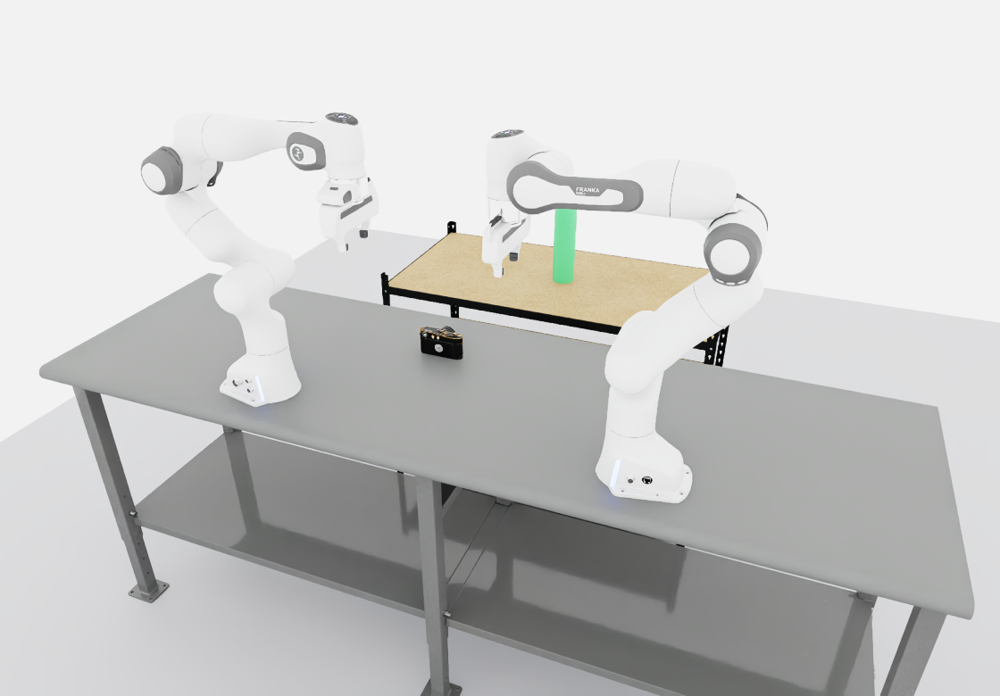
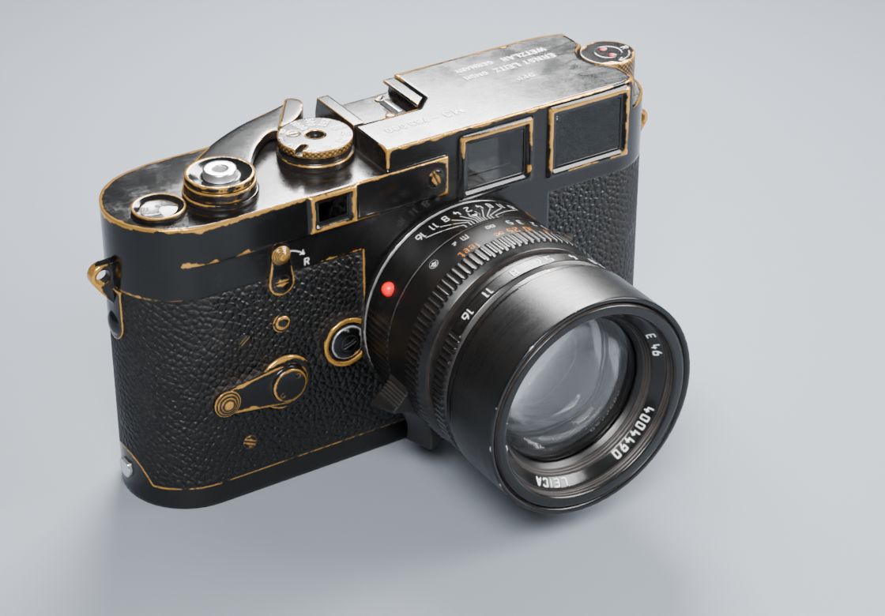
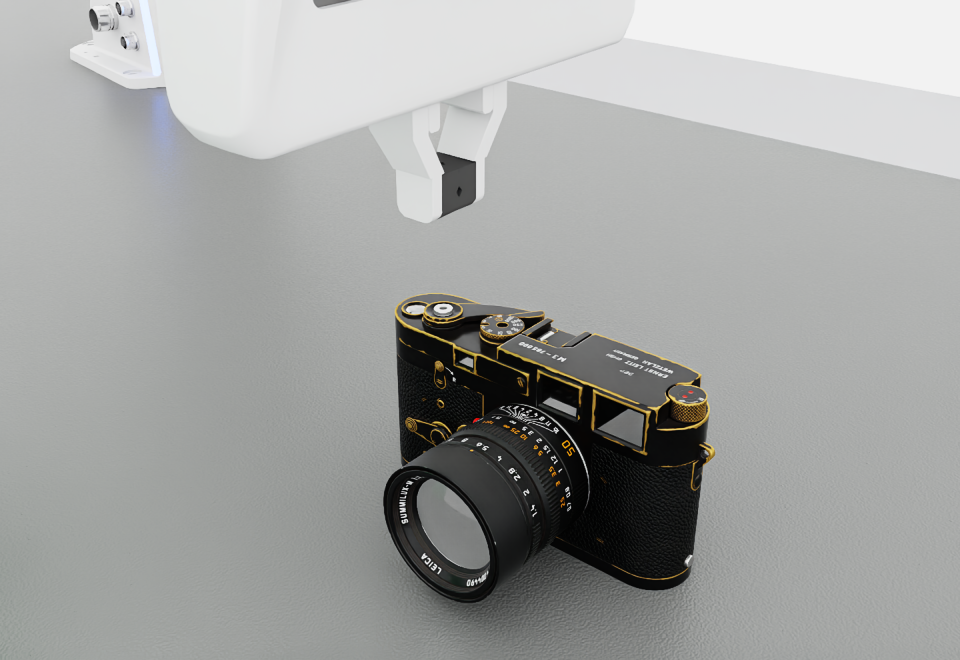
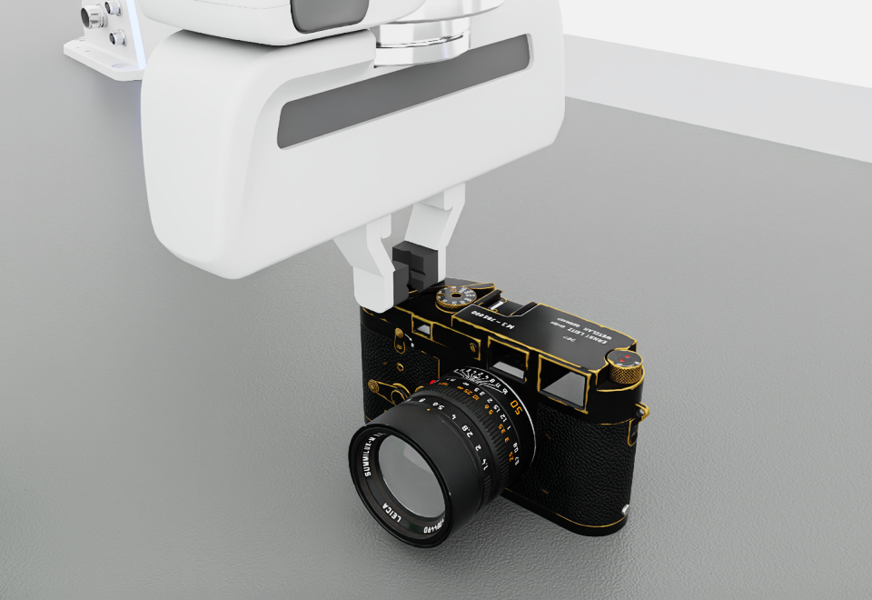

# Sequential Action Generation for Bimanual Manipulation

KAIST CS577 (Fall 2026), Team 8. The left Franka holds a camera, and the right presses its shutter. We fine-tune π0.5 for cumulative action generation (hand position → orientation → gripper motion).

## Layout

```
📁 robot-learning/
├── 📁 sim/
│   ├── 📁 assets/
│   ├── 📁 scenes/
│   ├── 📁 tasks/
│   ├── 📁 common/
│   └── 📁 scripts/
│       └── 📄 smoke_test.py
├── 📁 collect/    # Demo collection (next)
├── 📁 train/      # π0.5 fine-tuning (later)
├── 📁 docs/
├── 📁 third_party/
│   └── 📁 IsaacLab/  # v3.0.0, git submodule
├── 📄 environment.yml
└── 📄 README.md
```

## Setup

Requires Linux with an NVIDIA RTX GPU, Isaac Sim 6.2.0 (`environment.yml`), and Isaac Lab v3.0.0 (`third_party/IsaacLab` submodule).

```bash
git clone --recursive https://github.com/kaist-projects/cs50700-robot-learning.git
cd cs50700-robot-learning
conda env create -f environment.yml
conda activate isaacsim
# Install Isaac Lab in the active Conda environment
./third_party/IsaacLab/isaaclab.sh -i
```

## Simulation environment

In `Bimanual-CameraShutter-Franka`, the left arm holds and aims the camera at a green post while the right arm presses the shutter.

| Component | Setup |
| --- | --- |
| Simulator | Isaac Sim 6.2.0 with Isaac Lab v3.0.0 |
| Robot arms | Two fixed-base Franka Panda arms |
| Grippers | Franka Panda two-finger parallel grippers |
| Camera | Poly Haven's Camera 01 rangefinder model with a spring-loaded shutter button |



The right gripper closes as it approaches the shutter from above, then lowers onto the button.

| Camera prop in Blender | Before pressing | Shutter pressed |
| --- | --- | --- |
|  |  |  |

See the 16D action layout in [common/franka.py](sim/common/franka.py) and the scene and observation layouts in [camera_shutter.py](sim/tasks/camera_shutter.py).

Run the smoke test from the repository root:

```bash
conda activate isaacsim
python sim/scripts/smoke_test.py                        # headless
python sim/scripts/smoke_test.py --viz kit --keep_open  # GUI window
```

The smoke test presses the shutter, reports aim error, shutter travel, and task success, and saves RGB frames to `sim/outputs/smoke/`. The GUI command requires a desktop session and keeps the window open until you close it.

## Assets

All assets live in `sim/assets/`, so the environment needs no asset server. `sim/scenes/camera_shutter.usda` places the floor, the table, the rack, and the green post from these assets, and the task loads it as one fixture.

- `franka_panda/`: Isaac Lab's Franka Panda (`Isaac/IsaacLab/Robots/FrankaEmika/Legacy/` from NVIDIA's Isaac 6.1 asset server).
- `packing_table/`: the heavy-duty work table from Isaac's PackingTable prop (`Isaac/Props/PackingTable/props/SM_HeavyDutyPackingTable_C02_01/` from NVIDIA's Isaac 6.1 asset server), with only the textures its materials use. It is authored in centimetres, so the task scales it by 0.01.
- `office_rack/`: a 1 m storage rack from Isaac's Office environment (`Isaac/Environments/Office/Props/SM_Rack1m.usd` and its material from NVIDIA's Isaac 6.1 asset server). The green post stands on its top shelf. The material's default textures point at the rack textures, so no unused textures are needed.
- `camera_prop/`: a rangefinder camera with a spring-loaded shutter button. `camera.usda` holds the physics (links, joint, colliders). The visuals in `visuals/` come from Poly Haven [Camera 01](https://polyhaven.com/a/Camera_01) (CC0), split in Blender (`source/camera_01_split.blend`).
