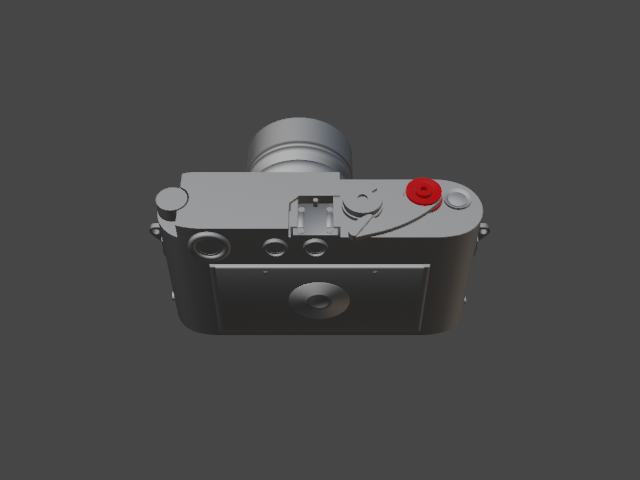

# Camera prop: realistic visuals from Blender

Status: done, 2026-11-23. Replaces the box-shaped camera prop's look while keeping its validated physics.

Outcome:
- The button island was the release head plus a fixed collar. Faces above z = 73.35 mm became the moving head (15.2 mm diameter, 4.8 mm tall); the collar stayed on the body. At the full 4 mm press the head is still 0.8 mm above the collar.
- Each object keeps only the material slots its faces use. Otherwise Blender's USD export bound the button to the first slot (`lens_body`) instead of `body`.
- The housing collider stops at the collar base (z = 71.5 mm) so the fingertip does not hit it before the button bottoms out. Colliders use `purpose = "guide"`, the same as the Franka asset's collision meshes.
- Smoke test: the shutter reaches -4.4 mm when pressed and returns to -0.2 mm (the button's own weight on the spring).

## Goal

The current `sim/assets/camera_prop/camera_prop.usda` is a dark box with a red cylinder. Its physics already works: the shutter joint reaches its -4 mm limit under a fingertip press and springs back. We keep that physics skeleton and swap only the visual meshes for a realistic camera.

## Asset search (done)

| Source | Result |
| --- | --- |
| NVIDIA `Isaac/Props/Camera/camera.usd` (6.1 server) | One static mesh, a camera on a tripod about 1 m tall, no joints (CC BY 4.0). Not usable. |
| NVIDIA Arena object library, SimReady | No camera. |
| PartNet-Mobility (via GAPartNet) | 32 cameras with prismatic "slider button" parts, URDF. Gated on Hugging Face, non-commercial research and education only, ShapeNet-grade meshes. Revisit if we need many camera variants (Pass 2 randomization). |
| Poly Haven `Camera_01` | Chosen. Leica M3-style rangefinder, CC0, 27k polygons, PBR textures, real scale. |

## Source asset facts

- Files: `https://api.polyhaven.com/files/Camera_01`, the `blend` format at 1k (0.96 MB `.blend` plus 7.9 MB of textures). 1k is enough for 224×224 policy images.
- Objects: `Camera_01` (one mesh; materials `body`, `lens_body`, `lens`) and `Camera_01_strap` (separate object, to delete).
- Frame: x = width, the lens points along -y, z = up, bottom at z ≈ 0. Units are metres at real scale.
- Size: 147 × 89 × 78 mm overall with lens. The main body island is 137 × 35 × 77 mm, so the 35 mm thickness fits the Franka gripper's 80 mm opening.
- Shutter button candidate: the mesh island centred at (-43.7, -5.8, 74.8) mm, 16.6 mm diameter, 6.6 mm tall, 644 faces, `body` material. It sits on the top plate at the film-advance lever pivot, where an M3's release button is (red in the render below). It may include the lever-pivot collar; confirm in the Blender GUI and split off only the button cap if so.



## Steps

1. **Blender edit.** Open the 1k `.blend`, delete the strap, and separate the button island into an object `shutter_button`. Rotate both objects +90° about z so the lens points along +x, which is the prop frame the env uses. Put the body origin at the bottom centre of the main body and the button origin at the bottom centre of the button, then apply transforms. Save the edited `.blend` as the source file.
2. **Export.** Export `camera_body.usdc` and `shutter_button.usdc` separately with UsdPreviewSurface materials and textures copied beside them. One file per object keeps each file's materials inside the prim that `camera_prop.usda` references.
3. **Physics skeleton.** In `camera_prop.usda`, make the `body` and `shutter_button` links reference the exported visuals. Refit the primitive colliders to the real body (a box of about 35 × 137 × 77 mm in the prop frame, plus a lens cylinder of about 52 mm diameter) and hide them from rendering. Move the joint's `localPos0` to the button's rest position. Keep the 4 mm travel and the spring unless we decide otherwise.
4. **Env update.** Set `CAMERA_PROP_START` for the new origin (bottom centre, so z ≈ 0), and update the smoke test's button-top offset to the new button height.
5. **Verify.** The smoke test must show the shutter at its limit when pressed and back near 0 when released. The table and wrist frames must show the textured camera. Then check the scene in the GUI.
6. **Docs and commits.** Record the provenance in the README asset list (Poly Haven `Camera_01`, CC0, author Rajil Jose Macatangay). Commit the asset change and the env change separately.

## Files

```
📁 sim/assets/camera_prop/
├── 📄 camera_prop.usda          # physics skeleton (links, joint, colliders) + references to visuals
├── 📁 visuals/                  # camera_body.usdc, shutter_button.usdc, textures/
└── 📁 source/                   # edited Camera_01 .blend
```

## Open points

- Confirm the button island in the GUI. If it includes the lever-pivot collar, split off only the cap.
- Check that colliders hidden from rendering (`purpose = "guide"` or invisible) still collide in PhysX before relying on them.
- The lens carries a "LEICA" engraving. The asset is CC0, but the trademark is still visible in images. That is fine for course work; reconsider before publishing renders widely.
