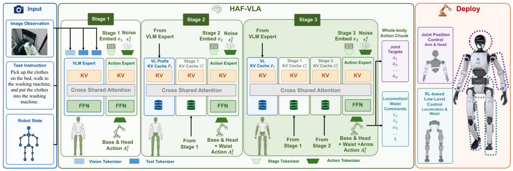
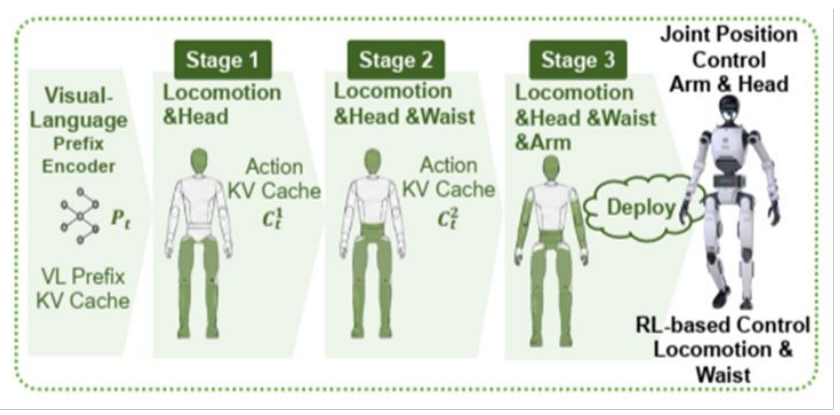
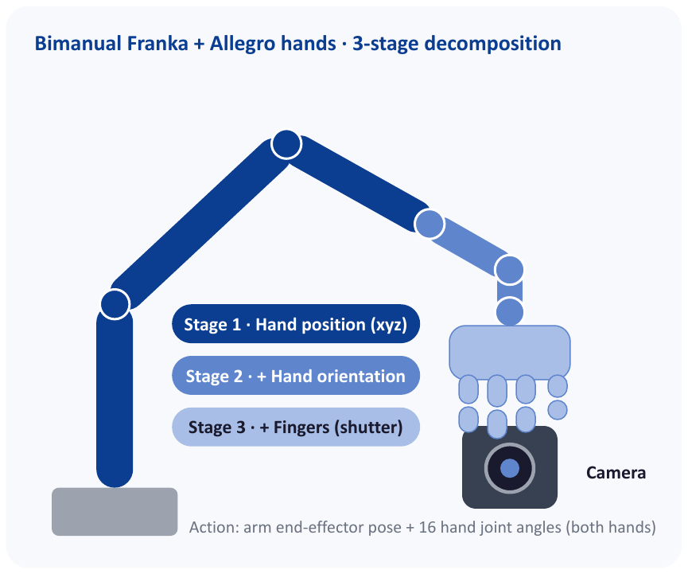
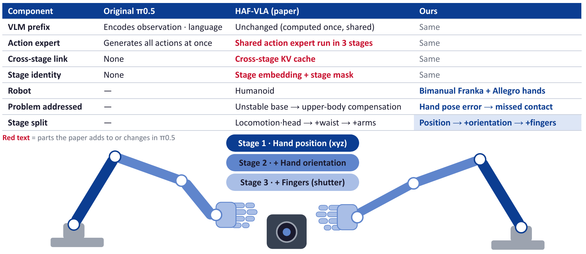
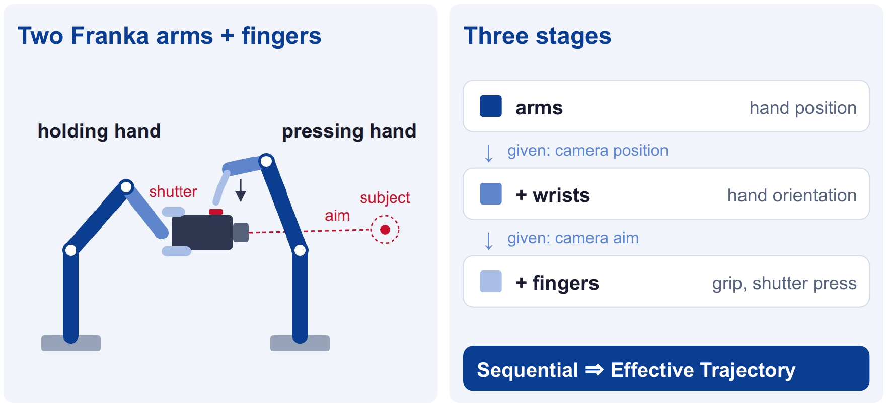
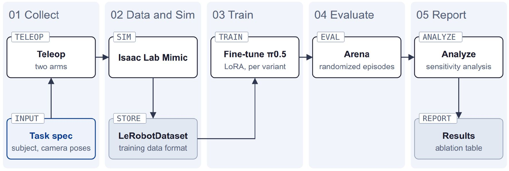
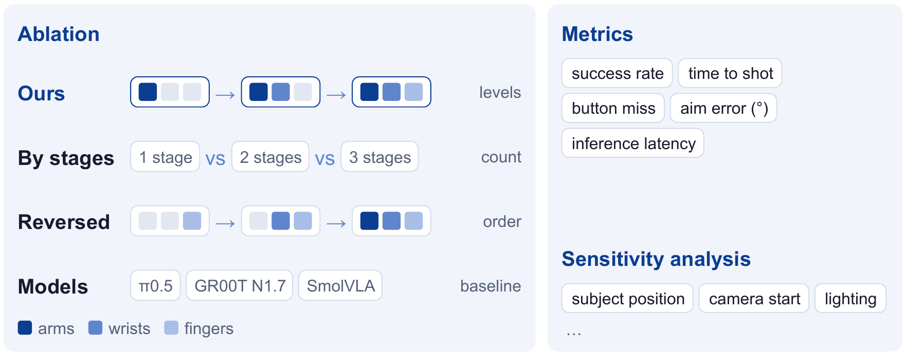

# Sequential Action Generation for Bimanual Manipulation

**Project proposal · Team 8 · Fall 2026**

Seojung Moon (20264311), Wonseok Jang (20254531), and Wenqu Fang (20220827)

Three-stage inference for bimanual manipulation proceeds from arms to wrists to fingers. The page numbers below refer to the [original proposal PDF](team8-proposal.pdf).

## Problem formulation (slides 2 and 4)

Can coarse-to-fine, cumulative action generation improve precision and coordination in bimanual dexterous manipulation compared with single-stage flow matching? The proposal draws on Hierarchical Action Flow (HAF) by Gu et al.

The project uses two fixed-base robotic arms with dexterous hands for tasks that require coordinated support, alignment, and fingertip interaction. End-effector position, orientation, and finger configuration are tightly coupled. Errors in one hand can disrupt the other hand's contact or grasp.

The architecture diagram on both slides shows image observations, a language task instruction, and robot state as inputs. The first stage computes a vision-language prefix and produces an action KV cache. Stage 2 attends to the prefix and Stage 1 caches, and Stage 3 attends to the prefix and both earlier stages' caches. Each stage has its own stage embedding and noise input. The final whole-body action chunk supplies joint targets for the arms and head and commands for the locomotion and waist controller.

## HAF-VLA architecture from the original paper (slide 3)

| Stage | Humanoid action dimensions |
| --- | --- |
| 1 | Locomotion and head |
| 2 | Locomotion and head, plus waist |
| 3 | Locomotion, head, and waist, plus arms |

Later stages refine the dimensions generated earlier and add new ones. The model runs a shared action expert with stage embeddings and cross-stage KV caching. It executes only the final action chunk and fine-tunes on demonstrations through imitation learning. At deployment, the humanoid uses joint-position control for the arms and head and RL-based low-level control for locomotion and the waist.

## Bimanual photograph task (slide 5)

The proposed embodiment is a pair of Franka arms with Allegro hands. The holding hand needs to establish the camera pose before the pressing hand can reliably press the shutter. The action includes an arm end-effector pose and 16 Allegro joint angles per hand.

1. Encode images and language once and share the vision-language context across all three stages.
2. **Stage 1 — arms.** Start from noise and generate both hands' positions (xyz).
3. **Stage 2 — wrists.** Condition on Stage 1 and regenerate position while adding orientation.
4. **Stage 3 — fingers.** Condition on Stages 1 and 2 and generate position, orientation, and finger actions. Execute only this final chunk.
5. During training, mask the demonstration actions by stage so each stage learns its corresponding subset of action dimensions.

The expected outcome is steadier camera support and more accurate shutter presses than single-stage π0.5 under the same data and inference budget.

## Changes to π0.5 (slide 6)

| Component | Original π0.5 | HAF-VLA (paper) | Bimanual proposal |
| --- | --- | --- | --- |
| VLM prefix | Encodes observations and language | Computed once and shared | Computed once and shared |
| Action expert | Generates all action dimensions at once | One shared expert runs in three stages | One shared expert runs in three stages |
| Cross-stage link | None | Cross-stage KV cache | Cross-stage KV cache |
| Stage identity | None | Stage embedding and stage mask | Stage embedding and stage mask |
| Robot | — | Humanoid | Two Franka arms with Allegro hands |
| Problem addressed | — | Upper-body compensation for an unstable base | Missed contact due to hand pose error |
| Stage split | — | Locomotion and head → +waist → +arms | Position → +orientation → +fingers |

## Camera shutter experiment setup (slide 7)

The holding hand grips and supports the camera, and the pressing hand reaches for the shutter button. The camera aims at a subject. The setup diagram shows the facing arms, the downward shutter press, and the line of aim from the camera to the subject.

| Generation stage | Role in the task |
| --- | --- |
| Arms | Set the hand positions and establish the camera position. |
| + Wrists | Set hand orientation given the camera position and establish camera aim. |
| + Fingers | Establish the grip and press the shutter given the camera aim. |

## Experiment pipeline (slide 8)

| Phase | Flow |
| --- | --- |
| Collect | Define the task spec with subject and camera poses, then collect demonstrations by teleoperating both arms. |
| Data and simulation | Augment the teleoperation demonstrations with Isaac Lab Mimic and store them in `LeRobotDataset` format for training. |
| Train | Fine-tune π0.5 with LoRA for each variant using the stored training data. |
| Evaluate | Run the fine-tuned variants in Isaac Lab Arena on randomized episodes. |
| Report | Analyze sensitivity and present the results in an ablation table. |

## Evaluation design (slide 9)

Does arm → wrist → fingers generation give a more precise, faster trajectory?

| Comparison | Variants |
| --- | --- |
| Proposed cumulative stages | Arms → arms and wrists → arms, wrists, and fingers |
| Stage count ablation | One stage vs. two stages vs. three stages |
| Stage order ablation | Fingers → fingers and wrists → fingers, wrists, and arms |
| Model baselines | Single-stage π0.5, GR00T N1.7, and SmolVLA |

**Metrics.** Success rate, time to shot, button miss, aim error (degrees), and inference latency.

**Sensitivity factors.** Subject position, camera starting pose, and lighting.

## Iterative plan (slide 10)

| Pass | Weeks | Data | Train | Evaluate | Check |
| --- | --- | --- | --- | --- | --- |
| 1 · Pipeline | 1–2 | Fixed setup | π0.5 | Fixed setup | Shutter pressed |
| 2 · Main results | 3–4 | Randomized setup | π0.5 and the proposed method | Randomized setup | Partial success |
| 3 · Ablation | 5–6 | Randomized setup | π0.5, the proposed method, and ablations | Randomized setup and sensitivity analysis | — |

Optional hardware evaluation would use a real Franka pair or a G1 upper body.

## References (slide 11)

1. L. Gu et al. (2026). *HAF-VLA: Hierarchical Action Flow Framework for Humanoid Vision-Language-Action Control*. arXiv:2610.26584.
2. Physical Intelligence et al. (2025). *π₀.₅: A Vision-Language-Action Model with Open-World Generalization*. arXiv:2504.16054.
3. M. Mittal et al. (2025). *Isaac Lab: A GPU-Accelerated Simulation Framework for Multi-Modal Robot Learning*. arXiv:2511.04831.
4. NVIDIA Isaac Lab-Arena. [Isaac Lab-Arena: Composable Environment Creation and Policy Evaluation for Robotics](https://github.com/isaac-sim/IsaacLab-Arena).
5. A. Mandlekar et al. (2023). *MimicGen: A Data Generation System for Scalable Robot Learning using Human Demonstrations*. CoRL. arXiv:2310.17596.
6. H. Wang et al. (2026). *DexJoCo: A Benchmark and Toolkit for Task-Oriented Dexterous Manipulation on MuJoCo*. arXiv:2605.16257.

## Q&A (slide 12)

Thank you. We welcome your questions and feedback.
